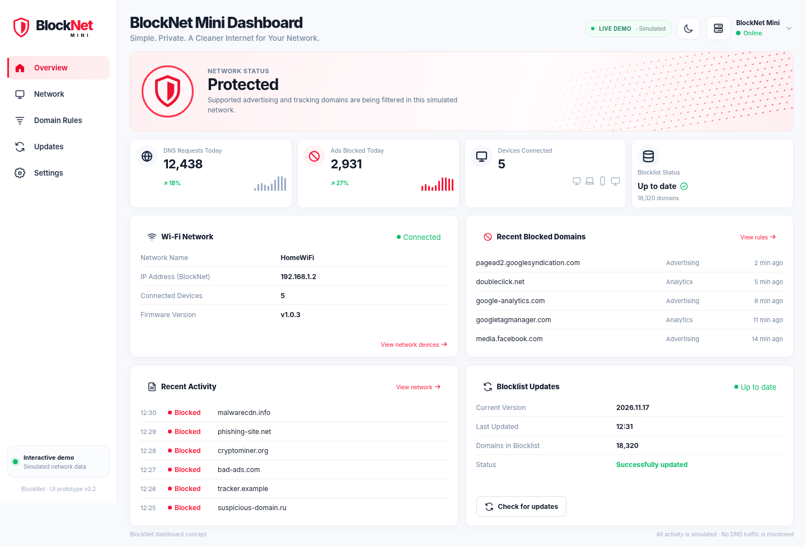
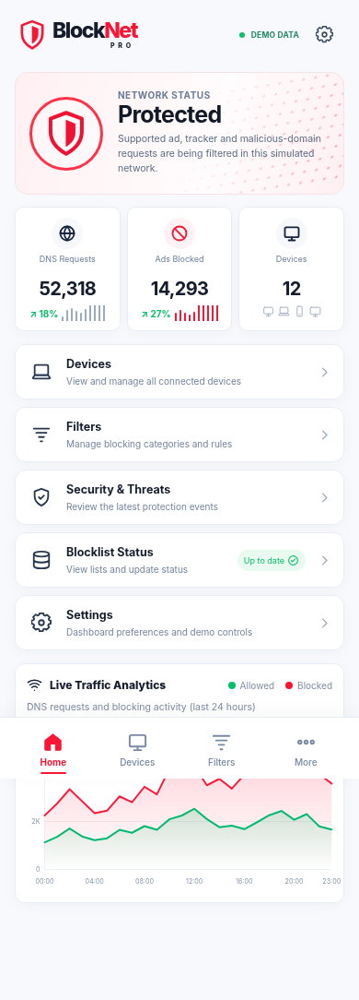
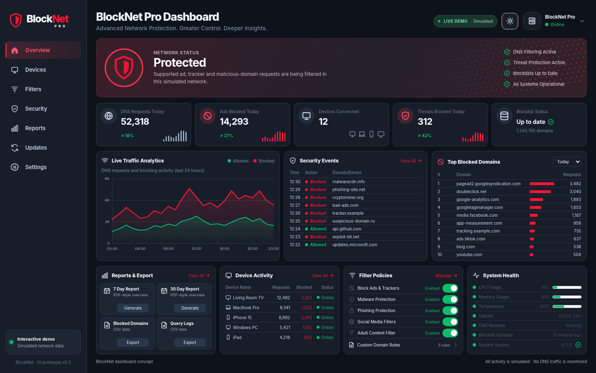
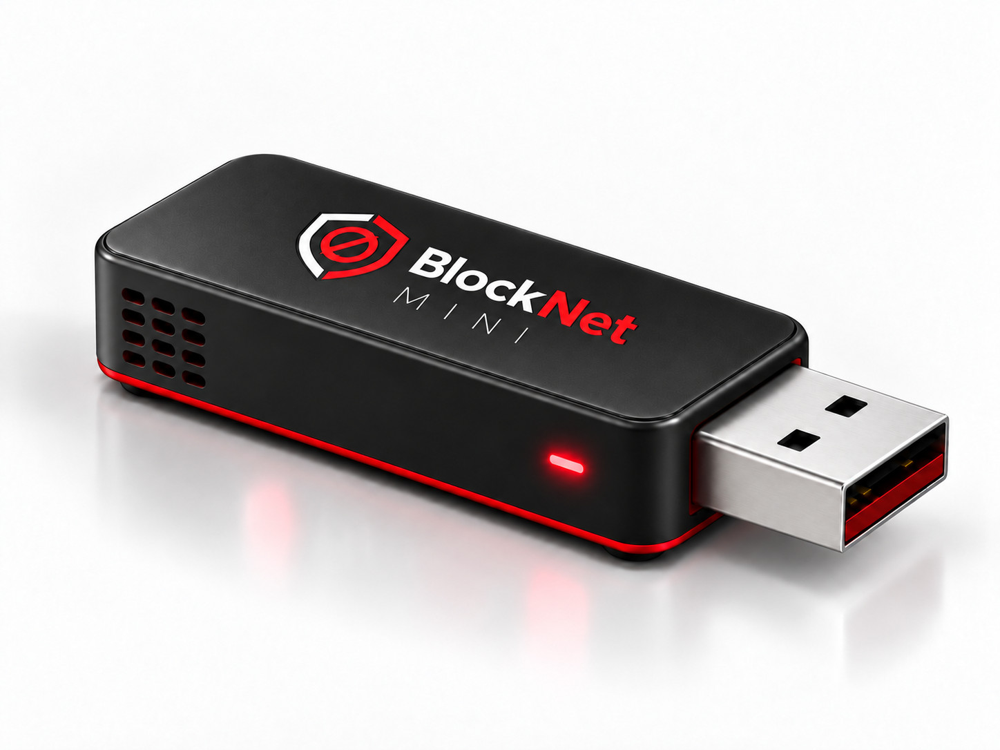
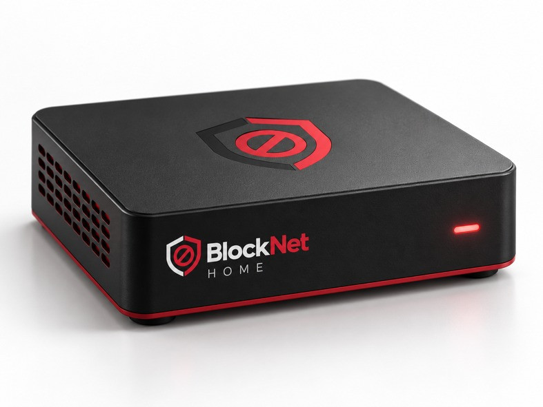

<p align="center">
  
</p>

<h1 align="center">BlockNet — Interactive Network Dashboard</h1>
<p align="center"><a href="https://blocknetdash.pages.dev/"><strong>🌐 Open the live BlockNet dashboard demo</strong></a></p>
<p align="center"><strong>Mini · Lite · Home · Pro</strong><br>Local DNS filtering hardware concepts and an interactive dashboard demonstration</p>

A polished, responsive **BlockNet Mini / Lite / Home / Pro dashboard prototype**, based on the BlockNet business plan and supplied UI mockups. The site works on desktop, tablet and mobile, with a live-looking simulation generated entirely inside your browser.

> **Interactive concept — not a real ad blocker.** No real network is monitored, no DNS requests are intercepted, and no physical BlockNet device is connected. Statistics, connected clients, logs, security events, update statuses and firmware versions are sample data. Do not use this demo to claim verified protection, manufacturing readiness or product availability.

## Preview

| Mini | Lite |
|:---:|:---:|
|  |  |

| Home | Pro |
|:---:|:---:|
|  |  |

| Mobile Pro | Pro dark mode |
|:---:|:---:|
|  |  |

## Device artwork

The following are **concept renders**, not photographs of manufactured products. All images below are from the supplied BlockNet business plan.

| Mini | Lite | Home | Pro |
|:---:|:---:|:---:|:---:|
|  |  |  |  |

See [all existing project artwork](docs/artwork-index.md) for packaging concepts, accessories, dashboard previews and the original brand image.

## Start the demo

**Option A — no installation:** Download/extract the files and open `index.html` in Firefox, Chrome, Edge or Safari.

**Option B — local web server:** From the project directory:

```bash
python -m http.server 8080
```

Open `http://localhost:8080`.

**Switch models:** Open **Settings → Demo controls → BlockNet model**, then select Mini, Lite, Home or Pro. The entire dashboard updates instantly, including its branding, navigation, displayed tools, sample metrics and network details. Your chosen model, dark mode, filters and demo settings are remembered by the browser when local storage is available.

## Product models

| Model | Planned device | Browser dashboard | Mobile companion app | Demo layout |
| --- | --- | --- | --- | --- |
| **Mini** | USB-powered ESP32-C3, 2.4 GHz Wi‑Fi | Basic rebranded firmware UI | **No** | Basic: overview, network, domain rules, updates, settings |
| **Lite** | Raspberry Pi 3 B+, Ethernet, Pi-hole | BlockNet UI | **No** | Basic: overview, network, domain rules, updates, settings |
| **Home** | Raspberry Pi 4 2 GB, Ethernet, Pi-hole | BlockNet UI | **Planned** | Advanced: traffic charts, clients, filtering, security and reports |
| **Pro** | Raspberry Pi 5 4 GB, Ethernet, Pi-hole, front display | BlockNet UI | **Planned** | Advanced: richer analytics, exports and system health |

This is a *responsive website*, not a downloadable Android or iOS app. The future companion app is in the business plan for Home/Pro only. **Family profiles and scheduled parental restrictions are excluded for all models.** The brand shield has no tick/check mark.

## Interactive features

- Continuous simulated DNS queries, blocked requests, events, clients and chart activity.
- Fully responsive desktop sidebar and mobile bottom navigation.
- Four-model preview selector that adapts the layout and sample telemetry.
- Light/dark mode with local persistence.
- Demo offline/reconnect controls, pause/resume updates and reset data.
- Device explorer, sample per-client filtering controls for supported model demos.
- Ad/tracker filters and sample allow/block domain rules. Mini's firmware feature set must be verified before a real implementation.
- CSV exports and printable HTML demo reports on the advanced model views.
- Local-only static files, no framework, build tools, account or server required.

## Deploy on Cloudflare Pages

This is a plain static HTML/CSS/JS demo, so **there is no npm install, build framework or required build step**.

1. Open [Cloudflare Workers & Pages](https://dash.cloudflare.com/) and choose **Create application → Pages → Import an existing Git repository**.
2. Connect GitHub and choose **`JNathan34/BlockNet`**.
3. Use **`main`** as the production branch; select **None** for the framework preset.
4. Set **Build command** to **`exit 0`** (or leave blank); **Build output directory** to **`.`**, the repository root containing `index.html`.
5. Deploy, then use the assigned `*.pages.dev` URL. Subsequent pushes to `main` deploy automatically after the repository is connected.

> Cloudflare Pages hosts this **simulated dashboard**, not DNS filtering or a customer shop. The separate BlockNet storefront, subscription billing, physical appliances and native Home/Pro app still require development. See [Cloudflare's static HTML guide](https://developers.cloudflare.com/pages/framework-guides/deploy-anything/).

## Project structure

```text
BlockNet/
├── index.html                    # Responsive interactive dashboard
├── styles.css                    # Desktop, mobile and theme layouts
├── app.js                        # Local simulated demo data and controls
├── favicon.svg                   # Legacy simple icon
├── README.md
├── assets/
│   ├── brand/
│   │   └── blocknet-icon.png     # Exact shield cropped from original logo
│   ├── previews/                 # Dashboard screenshots
│   └── product-renders/          # Original concept images and full brand logo
└── docs/
    ├── BlockNet_Business_Plan_2026.docx
    ├── artwork-index.md          # Linked gallery of original assets
    ├── implementation-notes.md
    └── references/               # Source design references
```

## Planning source and caveats

Primary source: `docs/BlockNet_Business_Plan_2026.docx`, particularly **pages 3, 7, 9–11 and 13–17**, which define device capabilities and show the desktop/mobile dashboards. The plan explicitly describes its photography and interface artwork as concepts, not completed software or shipped devices. Original concept renders from the plan are included as design references. The source document also describes monthly **BlockNet Flex** plans; this repository is only the *device management dashboard*, **not** a shop, checkout, payment system or subscription service.

Before connecting this UI to real hardware, build an authenticated local backend, verify API access to the chosen firmware or Pi-hole version, test router DNS requirements, secure device credentials and validate the actual telemetry. DNS filtering does **not** block every advert, substitute for antivirus or improve broadband throughput.

**Asset rights:** The logo, reference images, product renders and business plan were supplied as BlockNet project materials. No third-party license is granted by this repository. Review project content and private information before making the repository public.
