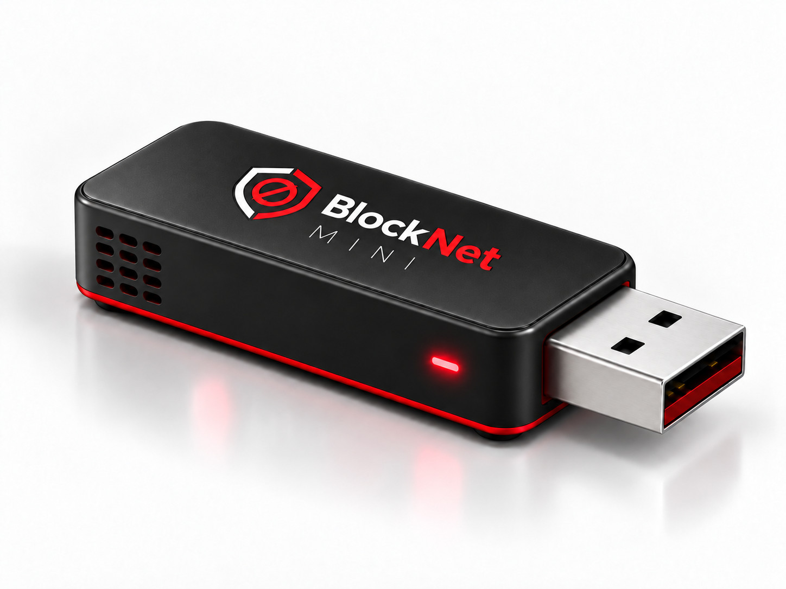
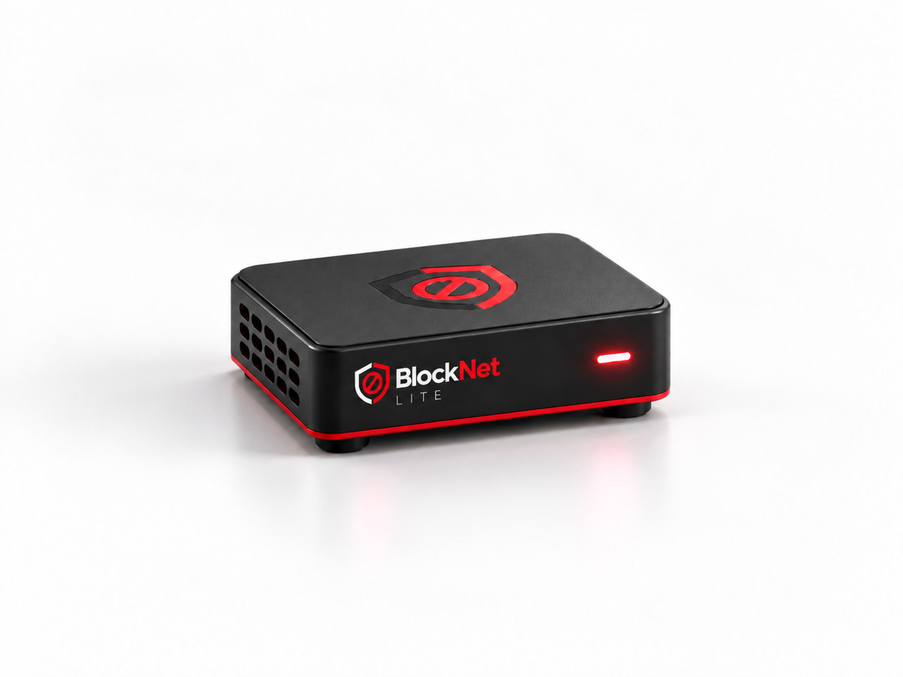
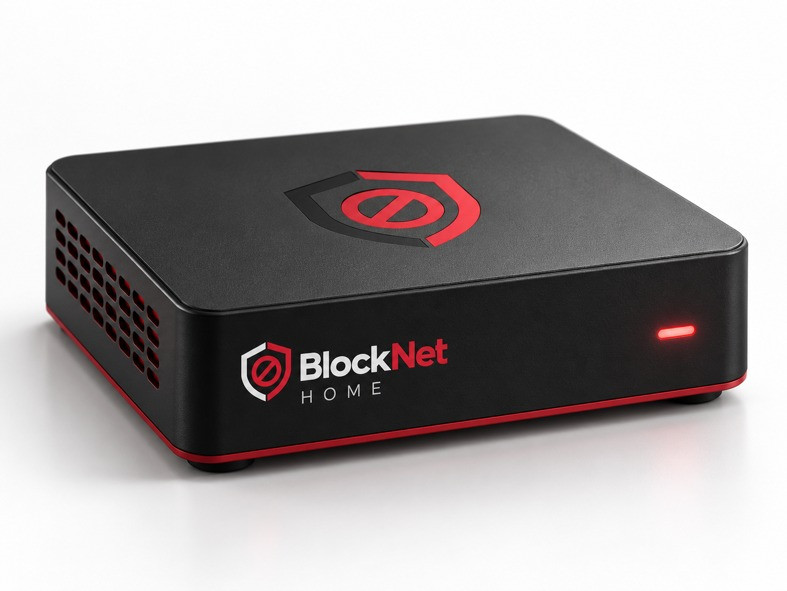
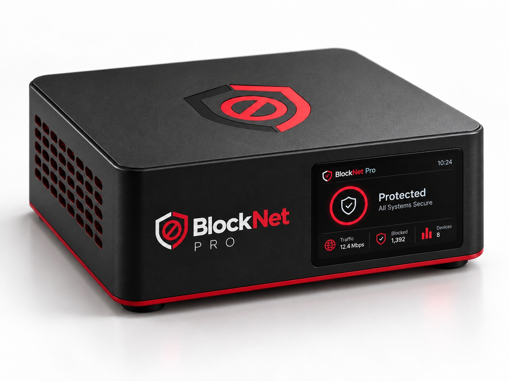
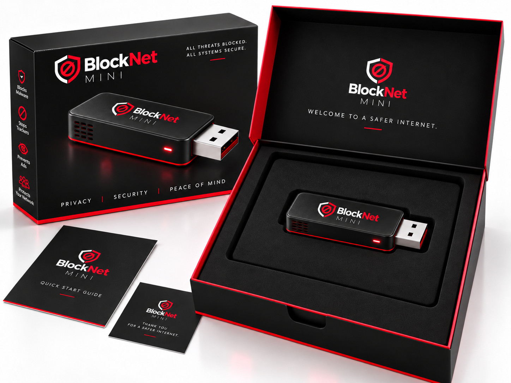
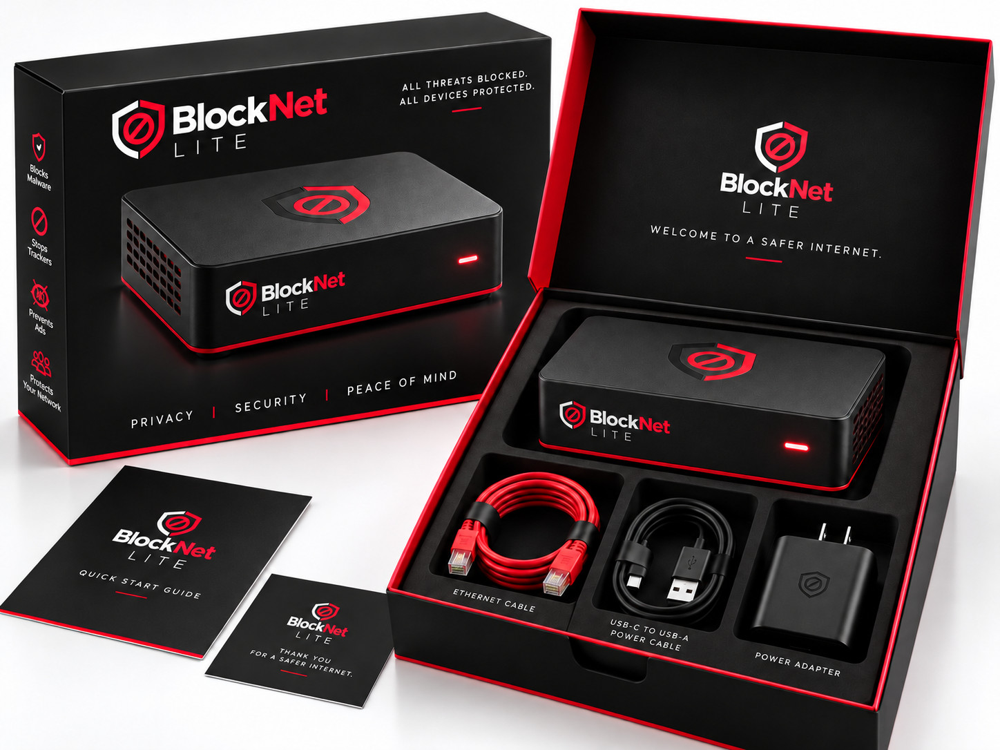
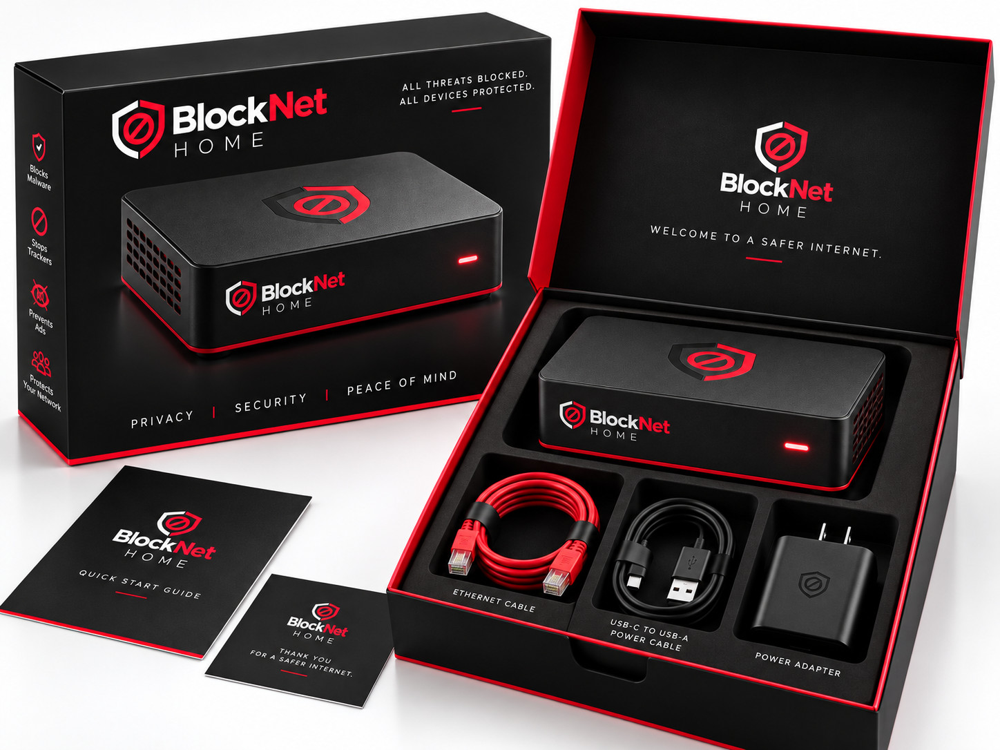
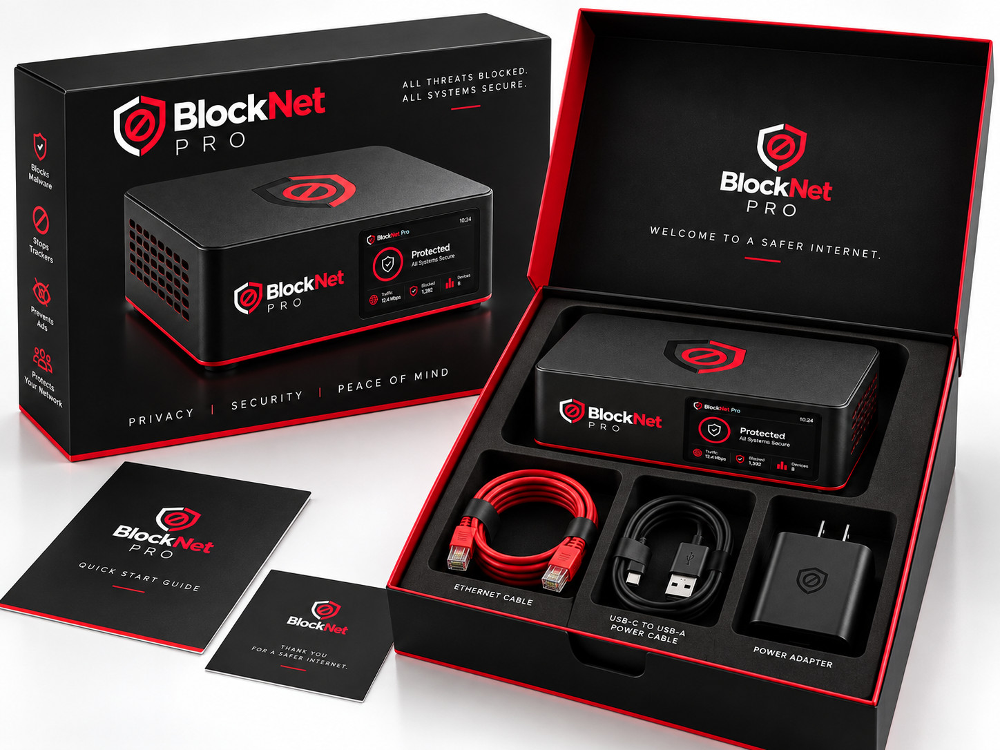
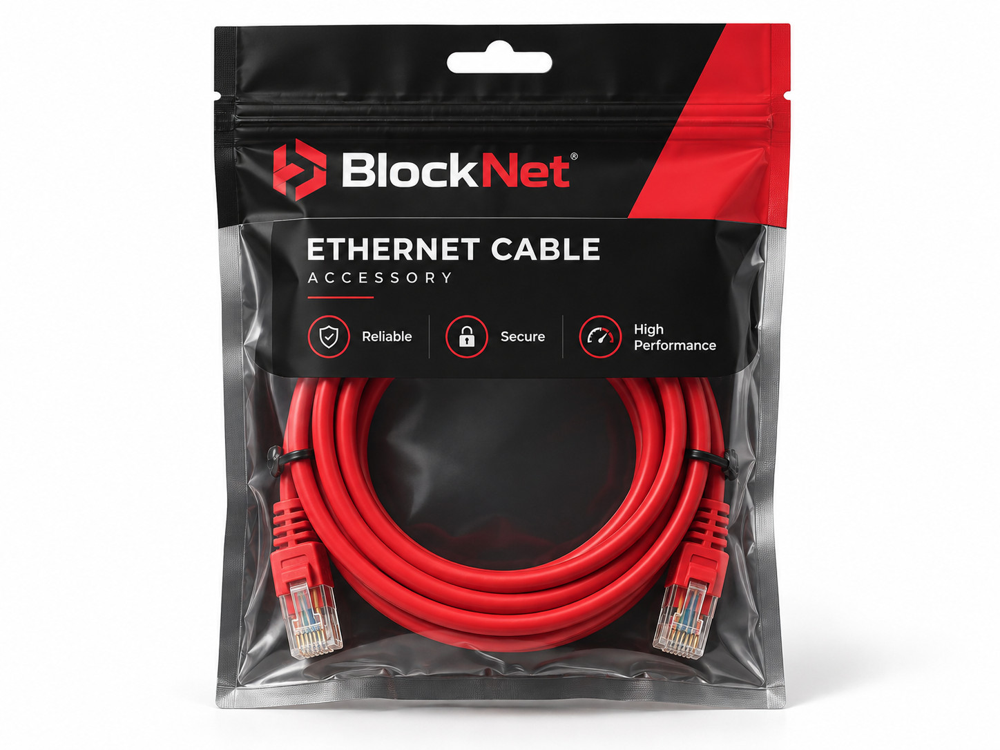
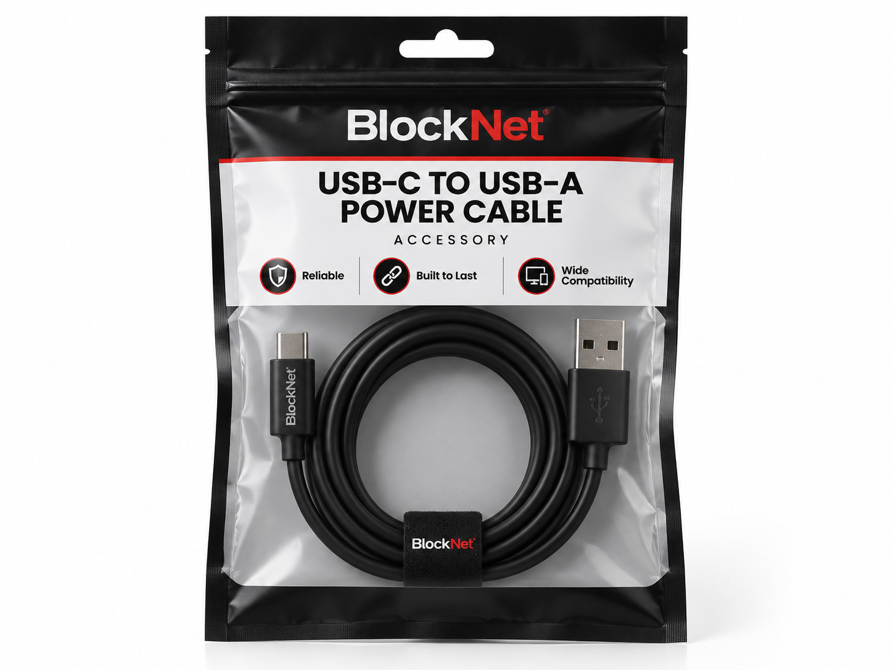

# BlockNet artwork library

All of the files linked below already belong to this project and are either sourced from the supplied BlockNet business plan or are existing GitHub assets. They are **concept artwork** until validated with physical products and working software.

## Brand

- [Full BlockNet logo](../assets/product-renders/brand-original.png)
- [Standalone shield favicon](../assets/brand/blocknet-icon.png) — cropped from the supplied full logo, not newly generated
- [Existing SVG shield](../favicon.svg) — simple legacy site icon

## Four product renders

| Mini | Lite | Home | Pro |
|:---:|:---:|:---:|:---:|
|  |  |  |  |

## Retail packaging

| Mini | Lite | Home | Pro |
|:---:|:---:|:---:|:---:|
|  |  |  |  |

## Accessories

| Red Ethernet cable | Power cable |
|:---:|:---:|
|  |  |

## Existing dashboard screenshots

| Model | Desktop | Mobile browser |
| --- | --- | --- |
| Mini | [Desktop](../assets/previews/mini-desktop.png) | [Mobile](../assets/previews/mini-mobile.png) |
| Lite | [Desktop](../assets/previews/lite-desktop.png) | [Mobile](../assets/previews/lite-mobile.png) |
| Home | [Desktop](../assets/previews/home-desktop.png) | [Mobile](../assets/previews/home-mobile.png) |
| Pro | [Desktop](../assets/previews/pro-desktop.png) / [Dark mode](../assets/previews/pro-dark-desktop.png) | [Mobile](../assets/previews/pro-mobile.png) |

## Reference mockups

The existing [docs/references](references/) folder includes original design references for Mini, Lite, Home, Pro desktop and Pro mobile, plus shield feedback.

### Usage notes

- Use these existing assets when expanding the Cloudflare Pages website or GitHub documentation. Keep the original black/red shield visual identity.
- Device renders, app mockups, packaging and the demo dashboard are **proposals and simulations**, not shipping product photos or a functioning customer service.
- The Home/Pro mobile app is planned but not released. Mini and Lite have browser interfaces only, and none of the models has family profiles.
